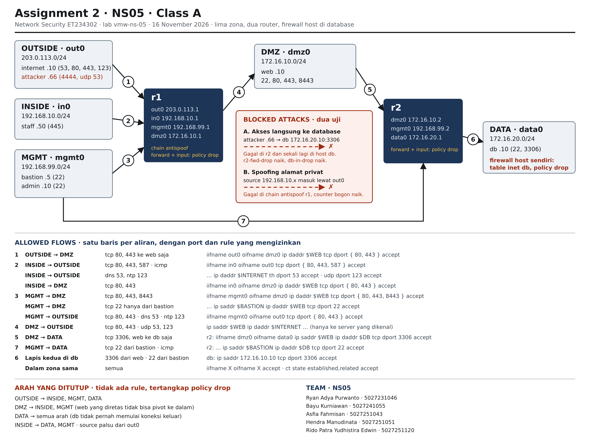

# Assignment 2 — Zone-Based Firewall

**Keamanan Jaringan Komputer / Network Security (ET234302)**
Departemen Teknologi Informasi, FTEIC, Institut Teknologi Sepuluh Nopember
Semester Gasal 2026/2027 · Week 11-12 · Kelompok **NS05** · lab `vmw-ns-05`

Dosen: Fuad Dary Rosyadi, S.Kom., M.Kom. dan Deka Julian Arrizki, S.Kom., M.Kom.

---

## Anggota kelompok

| Nama | NRP |
|---|---|
| Ryan Adya Purwanto | 5027231046 |
| Bayu Kurniawan | 5027241055 |
| Asfia Fahmisan | 5027251043 |
| Hendra Manudinata | 5027251051 |
| Rido Patra Yudhistira Edwin | 5027251120 |

---

## Diagram arsitektur



---

## Isi repo

| File | Keterangan |
|---|---|
| `diagram-arsitektur.png` | **Laporan satu halaman yang dikumpulkan.** Gambar arsitektur berisi enam baris rubrik. |
| `diagram-arsitektur.svg` | Sumber gambar, bisa diedit kalau ada perubahan. |
| `README.md` | Dokumen ini: langkah pengerjaan, rule, dan cara pembuktian. |
| `rules/r1.nft` | Salinan `/etc/lab/r1/r1.nft` |
| `rules/r2.nft` | Salinan `/etc/lab/r2/r2.nft` |
| `rules/db.nft` | Salinan `/etc/lab/db/db.nft` |
| `bukti/` | Output `nft list ruleset`, log drop, dan hasil probe |

---

## 1. Tugasnya apa

Lab datang dalam keadaan **jaringan sudah jalan dan terbuka lebar**. Tugas kami bukan menyambungkan jaringan, tapi **membatasi** dan membuktikan batasnya berlaku.

Perbandingan yang dipakai dosen:

| | GNS3 lab (Komdat) | Assignment 2 (Netsec) |
|---|---|---|
| Tujuan | semua host saling terjangkau | hentikan yang dilarang policy, sisanya boleh |
| Mulai dari | topologi kosong, tanpa alamat | jaringan jalan yang terbuka lebar |
| Yang dikonfigurasi | subnet, routing, switching | aturan firewall saja |
| Dinilai dengan | ping yang berhasil | paket dan serangan nyata, setelah kelas |
| Alat | router dan switch emulasi | nftables Linux di kernel nyata, lewat Teleport |

### Aturan main

| Hal | Ketentuan |
|---|---|
| Waktu | 90 menit. Menit 0-5 login Teleport, menit 5-90 mengerjakan 20 item policy. |
| Login | `teleport.it-its.id`, password dan MFA |
| Lab | satu lab per kelompok, `vmw-ns-05` untuk NS05 |
| File rule | `/etc/lab/r1/`, `/etc/lab/r2/`, `/etc/lab/db/` |
| Memuat rule | `sudo lab r1 nft -f /etc/lab/r1/<file>` |
| Skrip tes | **tidak ada.** Pembuktian dilakukan sendiri. |
| Penalti | membuka port 22, AI agent yang menjalankan perintah, memasang runtime baru, menghapus lab guard, mengubah Teleport |
| Kehilangan akses | menghentikan atau mengubah service Teleport |
| Diizinkan | bertanya ke AI di laptop, lalu mengetik sendiri perintahnya |

### Pembagian nilai

| Bobot | Komponen |
|---|---|
| 70% | Pemeriksaan lab: 20 item policy × 5 poin, diuji dengan paket nyata setelah kelas |
| 30% | Laporan arsitektur dan kontribusi tiap anggota, dikumpulkan di akhir sesi |

---

## 2. Topologi

Lima zona, dua router, dan satu firewall host di database.

### Zona

| Zona | Interface | Subnet | Host | Port yang dilayani |
|---|---|---|---|---|
| OUTSIDE | `out0` | 203.0.113.0/24 | internet .10 | tcp 22, 25, 53, 80, 443, 587, 8080, 8443 · udp 53, 123 |
| | | | attacker .66 | tcp 4444 · udp 53 |
| INSIDE | `in0` | 192.168.10.0/24 | staff .50 | tcp 445 |
| MGMT | `mgmt0` | 192.168.99.0/24 | bastion .5 | tcp 22 |
| | | | admin .10 | tcp 22 |
| DMZ | `dmz0` | 172.16.10.0/24 | web .10 | tcp 22, 80, 443, 8443 |
| DATA | `data0` | 172.16.20.0/24 | db .10 | tcp 22, 3306 |

### Router

| Perangkat | Interface dan IP | Peran |
|---|---|---|
| r1 | `out0` 203.0.113.1 · `in0` 192.168.10.1 · `mgmt0` 192.168.99.1 · `dmz0` 172.16.10.1 | firewall tepi, menghadap internet |
| r2 | `dmz0` 172.16.10.2 · `mgmt0` 192.168.99.2 · `data0` 172.16.20.1 | firewall dalam, melindungi zona DATA |
| db | host 172.16.20.10 | firewall host sendiri, `table inet db` |

Karena ada dua router, **satu aliran bisa melewati r1 lalu r2**. Kalau satu arah tidak jalan, periksa kedua ruleset, bukan hanya satu.

---

## 3. Langkah pengerjaan

### Menit 0-5 · Login

```bash
tsh login --proxy=teleport.it-its.id
tsh ssh ubuntu@vmw-ns-05
```

### Menit 5-15 · Recon, belum mengubah apa pun

Ini bagian yang paling sering dilewatkan dan paling menentukan. Policy-nya tersembunyi, jadi keadaan awal lab adalah petunjuk utamanya.

```bash
# daftar file rule dan konfigurasi layanan tiap zona
ls -la /etc/lab/r1/ /etc/lab/r2/ /etc/lab/db/
sudo cat /etc/lab/zone-services.json

# alamat dan rute tiap node
sudo lab r1 ip -br addr
sudo lab r2 ip -br addr
sudo lab db ip -br addr

# apa yang sedang mendengarkan di tiap host
sudo lab web  ss -tulpn
sudo lab db   ss -tulpn

# ruleset awal
sudo lab r1 nft list ruleset
sudo lab r2 nft list ruleset
sudo lab db nft list ruleset
```

Hasil recon dicatat ke `bukti/00-recon.txt`. Ini juga jadi bukti kondisi "before".

### Menit 15-20 · Gambar matriks arah

Lima zona menghasilkan **20 pasangan berarah** (5 × 4), jumlah yang sama dengan jumlah item policy. Buat tabel 5 × 5 di kertas, coret diagonalnya, lalu isi 20 kotak sisanya dengan keputusan: `inspect`, `pass`, atau `drop` berlog.

Kotak yang tidak diisi berarti poin yang hilang.

### Menit 20-70 · Tulis rule, muat, uji satu per satu

Jangan menulis semuanya lalu menguji di akhir. Satu rule, satu uji.

```bash
sudo nano /etc/lab/r1/r1.nft
sudo lab r1 nft -f /etc/lab/r1/r1.nft
sudo lab r1 nft list ruleset        # pastikan benar-benar termuat
```

Urutan dalam tiap chain:

1. `iif "lo" accept` (khusus chain input)
2. `jump antispoof` (khusus r1)
3. `ct state established,related accept`
4. `ct state invalid counter drop`
5. rule accept yang spesifik
6. `log prefix "..." counter drop` sebagai penutup

Alasan urutan ini: `established,related` di atas supaya balasan kembali tanpa membuka rule lebar, dan baris log di paling bawah supaya setiap drop tercatat dan terhitung.

### Menit 70-80 · Sapu kotak yang masih kosong

Kembali ke tabel 5 × 5. Arah yang belum diputuskan diberi keputusan eksplisit, minimal drop berlog.

### Menit 80-90 · Rapikan bukti dan laporan

Pastikan tiap policy punya empat hal: kalimat policy-nya, rule-nya, probe positif dan negatif, dan counter yang naik.

---

## 4. Rule yang dipakai

### `/etc/lab/r1/r1.nft` — firewall tepi

```nft
flush ruleset

define INTERNET = 203.0.113.10
define WEB      = 172.16.10.10
define BASTION  = 192.168.99.5
define BOGONS   = { 0.0.0.0/8, 10.0.0.0/8, 127.0.0.0/8, 169.254.0.0/16,
                    172.16.0.0/12, 192.168.0.0/16, 224.0.0.0/4 }

table inet r1 {
  chain antispoof {
    iifname "out0"  ip saddr $BOGONS counter drop
    iifname "in0"   ip saddr != 192.168.10.0/24 counter drop
    iifname "mgmt0" ip saddr != 192.168.99.0/24 counter drop
    iifname "dmz0"  ip saddr != { 172.16.10.0/24, 172.16.20.0/24 } counter drop
  }

  chain forward {
    type filter hook forward priority 0; policy drop;

    jump antispoof
    ct state established,related accept
    ct state invalid counter drop

    # zona yang sama
    iifname "in0"   oifname "in0"   accept
    iifname "mgmt0" oifname "mgmt0" accept
    iifname "dmz0"  oifname "dmz0"  accept
    iifname "out0"  oifname "out0"  accept

    # MGMT boleh ping ke mana saja, untuk monitoring
    iifname "mgmt0" icmp type echo-request accept

    # INSIDE ke OUTSIDE: web, submission 587 (bukan 25), DNS dan NTP ke server yang dikenal, ping
    iifname "in0" oifname "out0" tcp dport { 80, 443, 587 } accept
    iifname "in0" oifname "out0" ip daddr $INTERNET meta l4proto { tcp, udp } th dport 53 accept
    iifname "in0" oifname "out0" ip daddr $INTERNET udp dport 123 accept
    iifname "in0" oifname "out0" icmp type echo-request accept

    # INSIDE ke DMZ: web publik saja
    iifname "in0" oifname "dmz0" ip daddr $WEB tcp dport { 80, 443 } accept

    # MGMT ke DMZ: web dan panel admin 8443, SSH hanya dari bastion
    iifname "mgmt0" oifname "dmz0" ip daddr $WEB tcp dport { 80, 443, 8443 } accept
    iifname "mgmt0" oifname "dmz0" ip saddr $BASTION ip daddr $WEB tcp dport 22 accept

    # MGMT ke OUTSIDE: update, DNS, NTP
    iifname "mgmt0" oifname "out0" tcp dport { 80, 443 } accept
    iifname "mgmt0" oifname "out0" ip daddr $INTERNET meta l4proto { tcp, udp } th dport 53 accept
    iifname "mgmt0" oifname "out0" ip daddr $INTERNET udp dport 123 accept

    # OUTSIDE ke DMZ: web publik saja
    iifname "out0" oifname "dmz0" ip daddr $WEB tcp dport { 80, 443 } accept

    # DMZ ke OUTSIDE: hanya web, dan hanya ke server yang dikenal
    iifname "dmz0" oifname "out0" ip saddr $WEB ip daddr $INTERNET tcp dport { 80, 443 } accept
    iifname "dmz0" oifname "out0" ip saddr $WEB ip daddr $INTERNET udp dport { 53, 123 } accept

    limit rate 10/second burst 20 packets log prefix "r1-fwd-drop "
    counter drop
  }

  chain input {
    type filter hook input priority 0; policy drop;
    iif "lo" accept
    jump antispoof
    ct state established,related accept
    ct state invalid counter drop
    iifname "mgmt0" ip saddr $BASTION tcp dport 22 accept
    iifname { "in0", "mgmt0" } icmp type echo-request accept
    limit rate 10/second burst 20 packets log prefix "r1-in-drop "
    counter drop
  }
}
```

### `/etc/lab/r2/r2.nft` — firewall dalam

```nft
flush ruleset

define WEB     = 172.16.10.10
define BASTION = 192.168.99.5
define DB      = 172.16.20.10

table inet r2 {
  chain forward {
    type filter hook forward priority 0; policy drop;
    ct state established,related accept
    ct state invalid counter drop

    # aplikasi ke database saja
    iifname "dmz0"  oifname "data0" ip saddr $WEB     ip daddr $DB tcp dport 3306 accept
    # SSH ke database hanya lewat bastion
    iifname "mgmt0" oifname "data0" ip saddr $BASTION ip daddr $DB tcp dport 22 accept
    iifname "mgmt0" oifname "data0" icmp type echo-request accept

    log prefix "r2-fwd-drop " counter drop
  }

  chain input {
    type filter hook input priority 0; policy drop;
    iif "lo" accept
    ct state established,related accept
    ct state invalid counter drop
    iifname "mgmt0" ip saddr $BASTION tcp dport 22 accept
    iifname "mgmt0" icmp type echo-request accept
    log prefix "r2-in-drop " counter drop
  }
}
```

Tidak ada aturan dari `data0` ke mana pun, jadi **database tidak bisa memulai koneksi keluar**. Ini disengaja: database yang bisa menghubungi internet adalah jalur exfiltrasi.

### `/etc/lab/db/db.nft` — firewall host di database

```nft
flush ruleset

table inet db {
  chain input {
    type filter hook input priority 0; policy drop;
    iif "lo" accept
    ct state established,related accept
    ct state invalid counter drop
    ip saddr 172.16.10.10 tcp dport 3306 accept
    ip saddr 192.168.99.5 tcp dport 22 accept
    ip saddr 192.168.99.0/24 icmp type echo-request accept
    log prefix "db-in-drop " counter drop
  }
}
```

Ini lapis kedua. Kalau r2 jebol, database masih menolak siapa pun selain web server dan bastion.

---

## 5. Prinsip desain

| Prinsip | Alasan |
|---|---|
| Semua chain `policy drop` | Default discard. Yang tidak diizinkan eksplisit dibuang (Stallings 2023, Sec. 21.1). |
| `established,related` di atas | Balasan kembali sendiri, tanpa perlu rule lebar yang juga memasukkan penyerang. |
| `ct state invalid drop` | Membuang paket yang tidak cocok dengan state mana pun. |
| Chain `antispoof` di r1 | Paket dari internet yang mengaku beralamat privat dibuang (CIS 3.2.1). |
| DMZ tidak bisa ke INSIDE dan MGMT | Web server yang diretas tidak bisa pivot ke jaringan dalam. |
| DATA tidak memulai koneksi apa pun | Menutup jalur exfiltrasi dari database. |
| Akses admin hanya lewat bastion | Pola jump host. Satu pintu yang diawasi, bukan banyak pintu. |
| Firewall host di db | Defense in depth. Dua lapis harus jebol sebelum database tersentuh. |
| `log prefix` + `counter` di tiap penutup | Tanpa ini, drop tidak bisa dibuktikan. 30% nilai ada di pembuktian. |
| `limit rate` pada log di r1 | Mencegah log membanjiri disk saat ada flood. |

---

## 6. Pembuktian

### Melihat ruleset dan counter

```bash
sudo lab r1 nft list ruleset
sudo lab r2 nft list ruleset
sudo lab db nft list ruleset
```

Counter muncul sebagai `counter packets N bytes M` di baris drop. Urutannya: jalankan probe dulu, baru lihat counternya naik.

### Melihat log drop

```bash
journalctl -k | grep -E 'r1-fwd-drop|r1-in-drop|r2-fwd-drop|r2-in-drop|db-in-drop'
```

### Probe positif, yang seharusnya berhasil

```bash
sudo lab staff   curl -s -o /dev/null -w '%{http_code}\n' http://172.16.10.10      # INSIDE ke web
sudo lab internet curl -s -o /dev/null -w '%{http_code}\n' http://172.16.10.10     # OUTSIDE ke web
sudo lab web     nc -zv -w 2 172.16.20.10 3306                                     # web ke db
sudo lab bastion nc -zv -w 2 172.16.20.10 22                                       # bastion ke db
```

### Probe negatif, yang seharusnya gagal

```bash
sudo lab attacker nc -zv -w 2 172.16.20.10 3306   # internet ke database
sudo lab attacker nc -zv -w 2 192.168.10.50 445   # internet ke staf
sudo lab web      nc -zv -w 2 192.168.10.50 445   # DMZ pivot ke INSIDE
sudo lab admin    nc -zv -w 2 172.16.20.10 22     # admin tanpa lewat bastion
sudo lab web      nc -zv -w 2 203.0.113.66 4444   # kanal C2 dari DMZ ke attacker
```

### Dua serangan yang diuji dan hasilnya

| | Serangan | Yang dikirim | Hasil |
|---|---|---|---|
| A | Akses langsung ke database dari internet | `sudo lab attacker nc -zv -w 2 172.16.20.10 3306` | Gagal. `r2-fwd-drop` naik, dan `db-in-drop` juga naik. Dua lapis menahan. |
| B | Spoofing alamat privat dari internet | paket dengan source 192.168.10.x masuk lewat `out0` | Gagal di chain `antispoof` r1, counter bogon naik. |

---

## 7. Catatan integritas

Seluruh rule ditulis dan diketik sendiri oleh anggota kelompok. AI dipakai sebatas tanya jawab di laptop, sesuai aturan tugas.

Yang **tidak** dilakukan:

- Tidak ada AI agent yang menjalankan perintah di server, baik lewat `tsh` maupun lewat browser.
- Port 22 tidak dibuka dan OpenSSH tidak di-unmask.
- Tidak ada runtime baru yang dipasang.
- Lab guard tidak dihapus atau diubah.
- Service Teleport tidak dihentikan maupun diubah.
- Skrip penilai dan file sementara Ansible dosen tidak dicari, dibuka, maupun diubah.

Daftar 20 item policy memang dirahasiakan dosen. Policy yang kami terapkan di atas adalah **hasil penalaran sendiri** dari `zone-services.json`, topologi lab, dan prinsip pada materi Week 9 dan Week 11, bukan salinan kunci jawaban.

---

## 8. Rujukan

- Stallings, W. (2023). *Cryptography and Network Security* (8th ed.), Sec. 21.1, hal. 673.
- Joshi, J. et al. (2008). *Network Security: Know It All*, hal. 55.
- NIST SP 800-53 Rev. 5 — definisi defense in depth.
- Center for Internet Security. *CIS Cisco IOS 15 Benchmark v4.1.1* — kontrol 1.2.5 dan 3.2.1.
- Netfilter Project. *nftables wiki*, wiki.nftables.org.
- Slide kuliah Week 9 *System and Network Defense* dan Week 11 *ACLs and Zone-Based Firewalls*.
